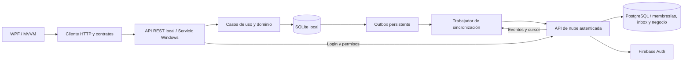

# Arquitectura adoptada — ADR 001

Fecha: 2026-10-31. Estado: aceptada para la primera versión de un negocio con una caja.

## Objetivo

Registrar ventas, consultar inventario e imprimir aunque no haya internet, mientras exista una sesión previamente validada y vigente. Iniciar sesión/cambiar de cuenta requiere conexión según [ADR 003](cloud-identity.md). La nube no forma parte de la transacción de venta. Sincronización eventual y administración central se incorporan alrededor de una autoridad local por tienda.

## Componentes

Monolito modular local y otro despliegue modular de nube. Cloud.Api implementa identidad central y recepción/descarga comercial contra PostgreSQL, comprobadas localmente; no hay nube desplegada. No se requieren microservicios, Kafka, Kubernetes ni infraestructura de mensajería para la primera tienda. REST define el límite entre procesos; las capas internas usan llamadas y puertos .NET. Ver [ADR 004](database-sync.md).

`Domain` no depende de UI, HTTP, SQLite ni Windows. `Application` define los puertos de persistencia y sincronización y coordina ciclos de envío. `Infrastructure` implementa SQL y transporte. `LocalApi` es la raíz de composición y administra el ciclo de vida Windows/console. `Contracts` contiene exclusivamente DTOs. `Client` solo conoce HTTP/Contracts. `Desktop.Wpf` usa MVVM y el cliente; no referencia el dominio ni la base.

La transacción del caso de uso está implementada por el adaptador de persistencia en esta primera etapa, respetando el puerto definido por Application. Se extraerán políticas adicionales a Domain/Application conforme se migren compras, descuentos y devoluciones; no se introduce un repositorio genérico por cada tabla.

## Flujo de una venta y sincronización

1. WPF crea y conserva un identificador de operación. El servicio valida unidades y consulta precios locales autorizados.
2. Una transacción SQLite inmediata verifica existencias, descuenta stock, inserta venta, líneas, movimientos, resultado idempotente y evento outbox.
3. El commit local confirma la venta. Impresión será una operación posterior reintentable, nunca un motivo para repetir el cobro o el descuento.
4. El trabajador consulta la outbox en orden de secuencia y envía eventos versionados al receptor.
5. El receptor valida identidad, guarda un inbox de deduplicación y confirma el `EventId` solo después de persistir.
6. El cliente marca el evento enviado solo al recibir el identificador correcto. Si el receptor guardó el evento pero la confirmación se perdió, se reenvía y el receptor devuelve el mismo acuse sin duplicar.

La entrega es al menos una vez con consumidores idempotentes, no una promesa de transporte exactamente una vez. [Referencia: patrón outbox de Microsoft](https://learn.microsoft.com/en-us/power-platform/architecture/reference-architectures/transactional-outbox-pattern).

Los reintentos tienen espera exponencial con variación aleatoria y un tope de 60 segundos. Fallos de autenticación/protocolo se muestran como `AttentionRequired`; no se confunden con falta de internet ni se descartan eventos. Una entrada incompatible bloquea las siguientes para preservar orden; soporte deberá resolverla. La outbox no se purga todavía.

## Autoridad y conflictos

La primera versión tiene una sola autoridad de stock por sucursal: el servicio y su SQLite. Si se agregan varias cajas en la misma tienda, se conectarán a esa autoridad mediante una red local protegida. Abrir el listener a LAN requiere un cambio explícito de autenticación, certificados y despliegue.

No se compartirá el archivo SQLite por red ni mediante carpetas sincronizadas. Tampoco se sumarán snapshots de existencias o se aplicará "el último gana" al stock.

Si el negocio necesita múltiples autoridades que vendan el mismo inventario sin conectividad entre ellas, deberá elegir reservas/cuotas por dispositivo o aceptar sobreventa y conciliación. Esto no puede resolverse únicamente con tecnología de sincronización.

Los eventos recibidos son inmutables. La descarga implementa cursor persistente e inbox, con datos y avance del cursor en una transacción local. PostgreSQL verifica una autoridad escritora activa por sucursal y permite réplicas de consulta. El reemplazo es explícito, con revocación del anterior; sus pendientes no se descartan. Edición remota de catálogo/precios y bajas lógicas serán eventos nuevos versionados en otra entrega.

## Datos y precisión

- Peso: entero de 64 bits en millonésimas de libra; 1 oz = 62,500; 1 lb = 1,000,000; 1 arroba = 25,000,000; 1 quintal = 100,000,000.
- Conteo: piezas enteras; un ciento son 100 piezas. No se admiten fracciones de una pieza.
- Las convenciones implementadas son comerciales de Guatemala. Antes de otra región se versionarán configuraciones, sin reinterpretar eventos históricos.
- Precios e importes en centavos GTQ para esta etapa. El total de cada línea se redondea al centavo con mitad alejándose de cero. Otras monedas, impuestos y precios de precisión superior requieren una política explícita posterior.
- Los `decimal` JSON de cantidades se convierten exactamente antes de tocar inventario. La base no usa REAL para stock o importes.
- Líneas de venta conservan nombre, unidad, cantidad, factor implícito en esquema v1 y precio histórico. No dependen del catálogo actual para reimprimir.
- Metadatos persistidos vinculan el archivo a negocio, tienda, dispositivo y moneda. Cambiar esa identidad en configuración provoca un error de arranque.

## Experiencia sin conexión

La interfaz consulta únicamente el servicio local. El estado de internet cambia un indicador inferior: `Sin conexión con la nube · N pendientes`, `Sincronizando`, `Cambios pendientes` o `Datos enviados a la nube`. Una sesión vigente permite vender sin nube hasta 24 horas desde la última validación. Login, administración y renovación requieren conexión; la pantalla de login WPF sigue pendiente.

Una falla del servicio local es diferente: allí no se pueden confirmar ventas. La pantalla debe avisar claramente y evitar presentar existencias guardadas en memoria como actuales. La base WPF conserva la última consulta pero la etiqueta como potencialmente desactualizada cuando no responde el servicio.

El estado refleja accesibilidad de nuestra API remota, no una prueba genérica de internet. Un endpoint sin configurar tiene su propio estado y nunca se muestra como sincronizado.

## Respaldo y disponibilidad

Sincronización no sustituye una política de respaldos. Se necesita backup consistente con la API de SQLite, cifrado, retención, claves recuperables y pruebas de restauración. En nube habrá respaldo de PostgreSQL y recuperación a un punto en el tiempo. Subir solo el archivo `.db` activo con WAL es incorrecto.

Están implementados backups locales consistentes y cifrados, sin sesiones, con sobre recuperable y manifiesto. También se verifica persistencia de eventos tras reinicio normal/forzado. Esto no protege datos que se pierdan antes de copiarlos/sincronizarlos fuera del equipo. Automatización, retención, restauración desde nube y objetivos medidos de recuperación siguen pendientes.

## Estado verificable

Implementados: proyectos separados, API local, SQLite v4 cifrada, identidad central Firebase, permisos por negocio/sucursal, dispositivos revocables, auditoría local/de dispositivos, entrada inicial, cierre de venta con actor, ledger, outbox, reintentos, PostgreSQL real en pruebas, proyecciones transaccionales, feed y restauración, conversor de legado, cliente y base WPF. Cifrado/recuperación en [ADR 002](backend-security.md), identidad en [ADR 003](cloud-identity.md) y persistencia/sync en [ADR 004](database-sync.md).

Pendientes: proyecto Firebase real, despliegue PostgreSQL administrado, imágenes, conciliación de aprovisionamiento de cuentas, auditoría completa, recuperación de backups con pendientes, pantalla de login/administración WPF, migración del negocio real, impuestos, caja, impresoras, HTTPS/ACL/instalador y pruebas en Windows. El receptor de tools sigue siendo exclusivamente de pruebas y no debe publicarse como nube.
