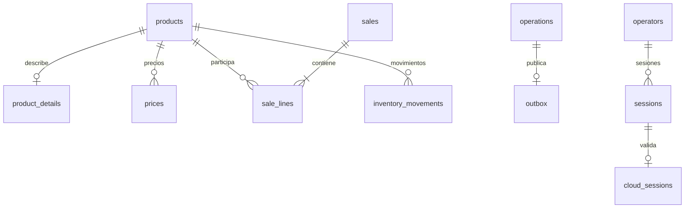

# ADR 004 — SQLite, PostgreSQL, conversión y sincronización

Fecha: 2026-11-01. Implementado y probado localmente. PostgreSQL 18.6 real en Docker, SQLite cifrada y Firebase Auth Emulator. Sin proyecto Firebase real, despliegue cloud ni habilitación de Production.

## Qué cambia en la base

SQLite sigue siendo el motor local. El cambio es su modelo de datos, sus restricciones y cómo se confirma y replica una operación.

| Referencia WinUI | Nuevo backend |
|---|---|
| Cinco tablas creadas con CREATE IF NOT EXISTS | SQLite v4: 17 tablas de aplicación, migraciones incrementales en transacción |
| Código de barras como identidad del producto | GUID estable y código de barras de texto opcional/único; conserva ceros iniciales |
| Stock NUMERIC ligado a la unidad comprada, sin versión de convención | BIGINT/INTEGER exacto en unidad base; las unidades comerciales se convierten explícitamente |
| Productos vendidos dentro de dos campos de texto | Cabecera de venta, líneas y movimientos relacionados, con cantidades/precios históricos |
| Datos y lógica SQL en ventanas | Persistencia exclusiva del servicio; WPF usa REST |
| Sin registro fiable de entrega a la nube | Outbox local, inbox central, secuencia, acuse persistido y feed por cursor |
| Fotos BLOB mezcladas con catálogo | Legado conservado cifrado; almacenamiento de objetos para imágenes pendiente |

En los archivos compilados del repositorio original hay tres bases con tablas `productos`, `unidades_venta`, `clientes`, `ventas` y `notificaciones`. Tienen entre cero y dos productos y no representan necesariamente la base del negocio actual. El código más reciente ya multiplica ciertas entradas por un factor de onzas/piezas, mientras los archivos antiguos carecen de un marcador de esa convención. No es seguro interpretar todos los números de la misma forma.

Las migraciones v1 → v4 de la base nueva **no reconvierten stock**: ya estaba en unidad base. La conversión de una base WinUI es un procedimiento separado sobre una copia.

## Esquema local

| Grupo | Tablas |
|---|---|
| Instalación y catálogo | installation, products, product_details, prices |
| Operación transaccional | operations, sales, sale_lines, inventory_movements, outbox |
| Caché de identidad y auditoría | operators, sessions, cloud_sessions, security_audit |
| Replicación | replication_state, replication_inbox |
| Conservación de legado | legacy_records, legacy_blobs |



Las 17 tablas excluyen tablas internas de SQLite. Los operadores locales son caché de perfiles/permisos; las cuentas Firebase no descargan contraseñas ni hashes de contraseña.

Peso: millonésimas de libra. Libra = 1,000,000; onza = 62,500; arroba comercial GT = 25,000,000; quintal GT = 100,000,000. Conteo: piezas enteras. Dinero: centavos GTQ, sin punto flotante. El redondeo de ventas nuevas es explícito por línea; la migración rechaza precios antiguos con fracciones de centavo.

## PostgreSQL y migraciones SQL

Cloud.Api mantiene identidad y negocio en módulos del mismo proceso. PostgreSQL conserva:

- cloud_stores y cloud_memberships: alcance y permisos.
- cloud_devices y cloud_device_audit: credenciales, revocaciones y reemplazos.
- cloud_replication y cloud_events: cursor, inbox de deduplicación y eventos originales.
- cloud_products, cloud_prices, cloud_sales, cloud_sale_lines y cloud_inventory_movements: proyecciones relacionales.
- cloud_legacy_records: archivo histórico textual convertido.
- cloud_schema_migrations: versión, hash SHA-256 y fecha.

DDL revisable en [001_identity.sql](../src/Agropecuaria.Cloud.Infrastructure/Migrations/001_identity.sql) y [002_replication.sql](../src/Agropecuaria.Cloud.Infrastructure/Migrations/002_replication.sql). Se aplican bajo lock de migración y una transacción. Una migración aplicada cuyo hash cambia provoca un rechazo; añadir otra versión para cambios posteriores.

La migración [003_account_provisioning.sql](../src/Agropecuaria.Cloud.Infrastructure/Migrations/003_account_provisioning.sql) añade el diario de alta de cuentas y auditoría central, sin modificar las versiones aplicadas anteriores.

Las claves y consultas incluyen negocio y sucursal. Las transacciones de recepción serializan modificaciones de una sucursal mediante un lock de su fila, sin bloquear todos los negocios en una misma cola. Las pruebas verifican aislamiento y concurrencia contra PostgreSQL real. El despliegue futuro debe separar el rol que aplica DDL del rol limitado de ejecución, configurar TLS, respaldos/PITR y observabilidad.

## Protocolo de sincronización

1. Una venta confirma líneas, stock, movimientos, resultado idempotente y outbox en una única transacción SQLite. No espera a PostgreSQL.
2. El trabajador se autentica con una credencial de dispositivo independiente de la sesión del operador.
3. PostgreSQL verifica dispositivo activo y escritor, alcance, versión, secuencia y contenido. El ID de negocio enviado en JSON no concede permisos.
4. En una transacción guarda inbox/evento, aplica catálogo o venta, escribe movimientos y avanza secuencia/cursor.
5. Solo después del commit devuelve el EventId. Si el acuse se pierde, el reenvío exacto devuelve el mismo acuse; un contenido diferente bajo ese ID se rechaza.
6. La descarga entrega páginas ordenadas con cursor por sucursal. SQLite aplica datos, inbox y cursor juntos; un error revierte toda la página.
7. Un evento propio ya existente se compara con el original y se confirma sin volver a descontar. Un evento descargado nunca genera outbox de regreso.

Eventos soportados: ProductRegistered, SaleCompleted y LegacyRecordArchived. El precio, nombre, cantidad y total de las ventas se concilian contra el catálogo precedente. No se usan snapshots sumados ni “el último gana” para inventario.

Los eventos nuevos conservan el hash de la solicitud para recuperar su resultado idempotente. Eventos anteriores sin ese hash conservan su efecto e identificador, pero un reintento de comando restaurado requiere conciliación y responde conflicto, en vez de volver a vender.

El trabajador reintenta automáticamente, con espera creciente. Un rechazo de protocolo o credencial se distingue de falta de conexión; no elimina pendientes. Si detecta revocación del dispositivo, bloquea nuevas escrituras locales.

## Autoridad de inventario y restauración

Una sucursal tiene **un solo escritor activo**. Más cajas deberán hablar con ese servicio por una LAN protegida en una entrega posterior. Los otros dispositivos de esta entrega son réplicas de consulta.

El registro requiere Admin online y una credencial aleatoria de 32 bytes. El secreto se prepara dentro de SQLite cifrada antes de llamar al servidor; PostgreSQL guarda solo su hash. Un registro cuyo acuse se pierde se puede reintentar con el mismo secreto, sin generar una segunda autoridad. Durante el registro pendiente no se permiten ventas.

`POST /api/admin/sync/enroll`:

```json
{ "canWrite": true, "replaceWriter": false }
```

Para una réplica vacía usar canWrite=false. Reemplazar escritor exige replaceWriter=true, revoca al anterior y queda auditado. No reanima un dispositivo previamente revocado.

Una instalación nueva con datos centrales comienza sin autoridad de venta y descarga el historial. Productos y ventas responden 409 mientras el inventario sea parcial; al alcanzar el cursor anunciado se habilita consulta y, si corresponde, escritura. Nunca se mezclan automáticamente una instalación con datos propios y otra historia ya existente en nube.

Un equipo desconectado no puede enterarse inmediatamente de su reemplazo. Al reconectar, su credencial se rechaza y conserva sus pendientes para conciliación. Antes de reemplazar físicamente una caja hay que revisar o recuperar sus operaciones no enviadas. Ningún login recupera información que jamás salió del disco perdido.

Un backup de un dispositivo enlazado excluye sesiones y credencial de dispositivo; queda sin escritura para impedir clonarlo como segunda caja. La reactivación de un backup con pendientes requiere un procedimiento de conciliación aún no implementado. La restauración desde los eventos centrales en una instalación vacía sí está probada.

## Conversión del legado

Se prepara una copia consistente de la base antigua mediante backup de SQLite o con el sistema cerrado y WAL consolidado. El conversor abre el origen en modo lectura y rechaza WAL activo. No usar como origen una copia incompleta del .db mientras la aplicación escribe.

```bash
mkdir -p .data/migration
bash scripts/security.sh legacy-plan /ruta/copia-antigua.db .data/migration/plan-sin-convencion.json Unspecified
```

Unspecified genera errores de convención que deben resolverse, con salida 3. Las selecciones disponibles son:

| Convención | Significado del stock antiguo |
|---|---|
| PurchasedUnit | La cantidad está expresada en unidad_comprada: 5 quintales = 500 lb |
| AtomicOunceOrPiece | El peso ya está en onzas y el conteo en piezas: 8,000 onzas = 500 lb |

Por ejemplo, 0.77 quintales bajo PurchasedUnit son 77 lb exactas. No elegir una convención solo porque el número parezca pequeño o grande: contrastar versión del programa, registros y conteo físico.

Tras confirmar PurchasedUnit, el comando sería:

```bash
bash scripts/security.sh legacy-plan /ruta/copia-antigua.db .data/migration/plan-revisable.json PurchasedUnit
```

Si la base mezcla convenciones, pasar un quinto argumento con un JSON de selección por código de barras. Los códigos no incluidos usan la convención general:

```json
{ "001234567890": "AtomicOunceOrPiece" }
```

El informe contiene hash del archivo, cantidades originales/convertidas, precios, metadatos, conteos, total histórico y errores/advertencias. Unidades desconocidas, relaciones inválidas, importes ambiguos y duplicados bloquean la conversión. Los informes contienen datos comerciales: guardarlos fuera de Git, preferiblemente en .data.

Con claves ya preparadas y la frase maestra suministrada de forma segura al proceso:

```bash
bash scripts/security.sh legacy-import /ruta/copia-antigua.db .data/conversion-revisada .data/migration/plan-revisable.json
```

El destino debe ser una carpeta nueva. Se comprueba que origen e informe sigan coincidiendo; se construye una base temporal cifrada, se verifican integridad, relaciones, existencias y archivos históricos y se publica una copia nueva. No adopta ni reemplaza automáticamente la instalación actual.

La carpeta completa contiene local.secure.db, installation.json, recovery-envelope.json y manifest.json. El material externo de recuperación no se copia. La ausencia de manifiesto indica una operación incompleta.

Se conservan códigos con ceros iniciales, tipo, marca, descripción y precios. Clientes, ventas, notificaciones y valores originales se archivan sin reinterpretar su estructura. Las ventas antiguas no aparecen como ventas nuevas ni vuelven a descontar stock. El costo original se conserva: antes de calcular valoración/margen hay que conciliar si representaba costo total, por unidad comprada o por unidad base.

Las fotos se conservan en legacy_blobs cifrada con sus hashes y referencias. El evento histórico contiene la referencia, no el binario. La subida/descarga de imágenes mediante almacenamiento de objetos está pendiente; una restauración solo desde nube todavía no recupera esos binarios.

Las tres bases archivadas del repositorio permanecen intactas. No se importó automáticamente ninguna ni se utilizó información del cliente como datos de prueba.

## Desarrollo y verificación

```bash
bash scripts/check.sh
bash scripts/postgres-dev.sh docker-start
bash scripts/postgres-dev.sh test
```

Con Firebase Auth Emulator activo en otra terminal:

```bash
bash scripts/cloud-dev.sh test
bash scripts/cloud-dev.sh test-postgres
```

La suite actual incluye 95 casos portables (82 generales, 10 PostgreSQL, 2 de Firebase y 1 de integración completa) y una prueba DPAPI exclusiva de Windows. La primera ejecución de CI verifica el backend en Linux y otro trabajo valida Windows/WPF. Cada prueba PostgreSQL usa un esquema temporal propio y lo elimina al terminar. El resultado verificable está en GitHub Actions.

Para probar manualmente los servidores, preparar claves y configuración, levantar Auth Emulator y PostgreSQL y usar:

```bash
bash scripts/cloud-dev.sh migrate-postgres
bash scripts/cloud-dev.sh bootstrap-owner-postgres
bash scripts/cloud-dev.sh authority-postgres
```

Mantener la autoridad en una terminal; en otra ejecutar api-cloud. Después iniciar sesión y registrar el dispositivo vía REST. No se creó una cuenta personal por defecto. El emulador es local y no protege frente a perder la Mac.

En VS Code están disponibles Cloud.Api (PostgreSQL local + Firebase emulado), Backend local (Mac) y tareas de PostgreSQL/integración. El perfil Backend local activa modo Cloud; la antigua autoridad SQLite se mantiene solo para las pruebas de identidad.

## Límites pendientes

Proyecto Firebase real y despliegue, TLS y permisos Windows, KMS/cifrado en reposo del servicio administrado, imágenes, auditoría central de cuentas y conciliación de alta Firebase, copias/PITR ensayadas, reactivación segura de backups con pendientes y snapshots de restauración para historiales grandes.

No hay aún edición remota de catálogo, compras, devoluciones, lotes, facturación, caja WPF o instalación/impresión Windows. PostgreSQL del contenedor es un entorno de desarrollo, sin promesa de alta disponibilidad o seguridad de producción.

Referencias: [locks PostgreSQL](https://www.postgresql.org/docs/18/explicit-locking.html), [construcción local](https://www.postgresql.org/docs/18/install-make.html), [autenticación SCRAM](https://www.postgresql.org/docs/18/auth-password.html), [SQLite Backup API](https://www.sqlite.org/backup.html).
